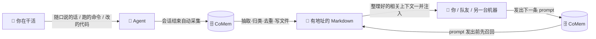
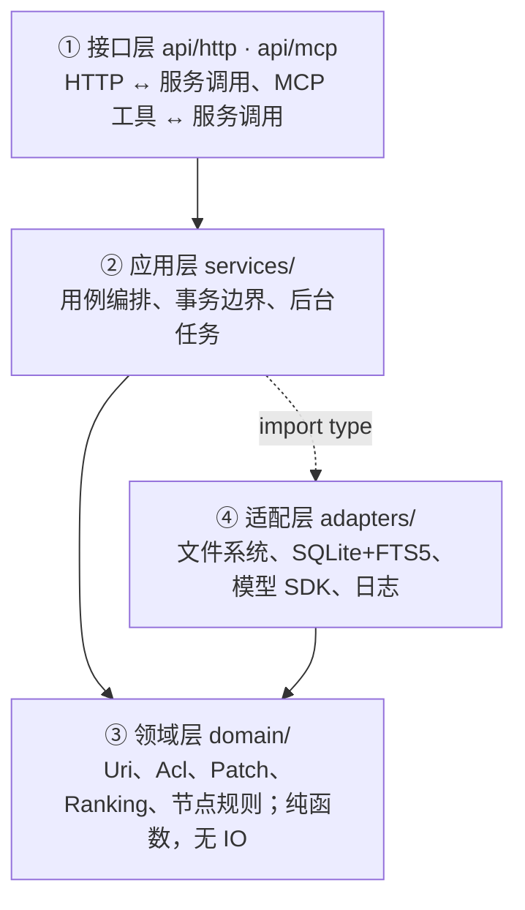

<div align="center">

# CoMem

### 让 AI agent 真正记住「你是谁、你在做什么」

**一个开源、自托管、可检查的 AI agent 上下文记忆数据库**

[docs/architecture.md](docs/architecture.md) · [docs/operations.md](docs/operations.md) · [docs/coverage-map.md](docs/coverage-map.md) · [集成指南](integrations/README.md) · [问题反馈](https://github.com/Micraow/CoMem/issues)

<p>
  
  
  
  
  
  
  
  
  
</p>

</div>

---

昨天你让 agent 排查一个问题，它翻了三层目录、读了五个文件、最后定位到一个 `Settings::nextHop` 是三级映射的坑。今天开个新会话问它同样的事，它从零开始再翻一遍——因为它只记得上下文窗口里的东西，而上下文窗口是**会话级**的，关掉就没了。

CoMem 给 agent 一个稳定地址（`comem://`），让它在不同会话、不同机器、不同队友之间共享「它知道的东西」。记忆是**你磁盘上的 Markdown 文件**——看得见、改得动、可以 `git diff`。没有黑箱，没有「存进去就查不出来」的失望。

### 它记的不是「你说过什么偏好」，而是「你干活时暴露过什么」

你很少会专门告诉 agent「我的开发机是 M5 Pro、我的项目用 pnpm」。这些信息是在**干活时顺手暴露**的：

- 某次让它排查问题，它跑了一条 `uname -m`，记下了你的机器型号；
- 某次你随口抱怨「这破 CI 又要跑二十分钟」，它记下了你对 CI 环境的不满；
- 某次它改代码，摸清了你项目里 `Settings::nextHop` 是三级映射——**这个事实以后不该再被它猜一遍**；
- 某次你在评审里说「以后并发这块别用双重检查锁」，它记下了一条约束。

这些零散的、你从没打算「存下来」的东西，被 CoMem 在会话结束后**自动抽取、归类、写成有条理的记忆**。下一次你在新会话里发出第一条 prompt 的时候，**在 prompt 送到模型之前**，CoMem 已经根据这条 prompt 检索了相关记忆、把命中的上下文整理好、注入进去了——你什么都不用做。



### 一份记忆，一个团队共用

记忆是有 URI 的资源，`comem://group/eng/...` 下的内容对**组内所有人可见**。同一个项目里，A 摸索出来的部署坑、B 踩过的 API 陷阱、C 定下的代码规范，都落在同一棵记忆树里。**下一个人接手时，不用从头再踩一遍**——他发出第一条 prompt 时就已经拿到了。

权限按目录继承、按主体发牌（`user` / `group` / `user:*`），`deny` 优先级最高。共享到什么粒度，你自己决定。

---

## ✨ 为什么是 CoMem

| | 你能得到什么 |
|---|---|
| 🎣 **被动捕获，零负担** | 不用教 agent「记这个」。它在干活时看到的事实、你的一句抱怨、它摸清的架构细节，会话结束自动抽取归档。**前提是装了宿主 Hook**，见下文「被动捕获需要什么才能生效」。 |
| 👥 **多人共享同一份上下文** | 记忆是有 URI 的资源，`group` 作用域下组内全员可见。新人接手直接从记忆树起步，不从零踩坑。 |
| 🪜 **复杂的分级设计** | 三层加载（L0 摘要 256 字 / L1 概览 / L2 原文）+ 目录作用域 + 记忆类型分桶 + ACL 继承链。先判断相关性、再决定读多深。 |
| 💰 **省 token，真的省** | 注入的是**索引**不是正文：一条记忆一行「摘要 + `comem://` 地址」，细节按需读原文；超出预算时按固定顺序降级（技能清单 → 召回 → 偏好 → 画像）。画像超 800 字自动整份重写收敛。不是「塞得越多越好」。 |
| 🎯 **召回质量有数字** | hybrid 检索 Recall@10 **0.904** / MRR **0.852**，纯关键词只有 0.315——`pnpm eval` 可复现，不是你信不信的问题。 |
| 📂 **记忆就是文件** | 每条记忆是一个有 URI 的 Markdown 文件，目录即作用域。任何编辑器打开、任何工具搜索、`git diff` 看改动。 |
| 🧩 **16 个 MCP 工具，不多不少** | 刻意克制。工具越多模型越容易选错，越难被信任。 |
| 🏠 **自托管，数据在你手里** | 一个 Docker 镜像、一个 SQLite 文件、一个数据目录。随时备份、随时迁移。 |

> 演示时「看起来能跑」不是标准。标准是**别人按文档部署后能不能用**——所以配置项真的生效，错误真的能定位，已知限制写在文档里而不是留给你踩。

---

## 🚀 快速开始

### 方式一：Docker（推荐）

需要 Docker 与 Docker Compose。整条命令都在本机 `127.0.0.1` 上，不对外监听。

```bash
git clone https://github.com/Micraow/CoMem.git
cd CoMem
cp config.example.yaml config.yaml     # compose 部署必需；不用配置文件时改用下面的 docker run
docker compose build
docker compose up -d
curl http://127.0.0.1:18080/health     # {"status":"ok",...}
```

**不需要任何密钥就能起服务。** `config.yaml` 是本地文件、不进版本控制。模板里
`providers.llm.default.apiKey` 与 `providers.embedding.apiKey` 都是空串——摘要、记忆抽取、
合并与检索改写要接真实模型才工作，接的时候在 `config.yaml` 里填 key，或用环境变量
`COMEM_PROVIDERS_LLM_DEFAULT_API_KEY` / `COMEM_PROVIDERS_EMBEDDING_API_KEY` 覆盖。

**`docker compose` 部署要先有 `config.yaml`。** compose 会把 `./config.yaml` 挂进容器；
文件不存在时 Docker 会在宿主建一个同名目录，启动报 `EISDIR: illegal operation on a directory, read`。
上面那条 `cp config.example.yaml config.yaml` 不是可选的。完全不用配置文件时，改用
`docker run` 且不挂载它（全部走默认值，会 warn 一条占位的 `baseUrl`）。

**「留空」与「不设置」不是一回事。** 空串是「没有密钥」，能启动；`${VAR}` 引用的环境变量
**没设置**时启动直接失败（`配置文件引用了未设置的环境变量 ...`），即使那个 provider 是
`disabled`。这两条混起来是「复制完启动不了」最常见的原因。

**如果你手上已经有一份 `config.yaml`**（例如从别的机器拷来的），它是**那台机器**的配置：
`dataDir`、`baseUrl`、`ingest.paths` 都可能指向本机不存在的路径，还带着别人的密钥。从零
开始请先把它移走（`mv config.yaml config.yaml.bak`），再决定要不要从模板重建。

打开浏览器访问 **http://127.0.0.1:18080**，就是控制台。

<details>
<summary><strong>需要容器内本地推理（embedding / rerank 不依赖外部 API）？</strong></summary>

```bash
docker compose --profile inference build   # 比核心镜像大 ~647 MB
docker compose --profile inference up -d
```

推理镜像把 llama.cpp 编进容器，模型在首次启动时按需下载到数据卷。不需要就跳过——默认核心镜像走远程 OpenAI 兼容 API。
</details>

<details>
<summary><strong>只用 Dockerfile、不用 Compose？</strong></summary>

```bash
docker build -t comem:local .
docker run -d --name comem \
  -p 127.0.0.1:1933:1933 \
  -v comem-data:/var/lib/comem \
  -e COMEM_DATA_DIR=/var/lib/comem \
  comem:local
```

注意：单独跑后端时控制台不在同源，得自己配一层反向代理把 `/api` 转给后端——`docker-compose.yaml` 里的 nginx 就是在做这件事，直接抄它即可。
</details>

### 方式二：本地开发

需要 **Node ≥ 22.5**（依赖内置 `node:sqlite`）与 **pnpm**。

```bash
pnpm install
cd web && pnpm install && cd ..   # 控制台独立 lockfile，会触发 nuxt prepare 生成类型
pnpm dev
```

`pnpm dev` 同时起后端（`http://127.0.0.1:1933`）与控制台（`http://127.0.0.1:3081`）。只要后端跑 `pnpm dev:server`，只要控制台跑 `pnpm dev:web`。

<details>
<summary><strong>一条命令跑完整链路（不需要模型凭据）</strong></summary>

```bash
pnpm test:e2e
```

它起服务、写记忆、检索、归档会话、跑完阶段二、过复核、生成摘要、演示 ACL，跑完自动停。用临时数据根，不碰你的真实数据。
</details>

### 第一个账号从哪来

**认证恒开，控制台只有一条首跑路径**：起服务 → 从启动日志拿初始化令牌 → `/setup` 建管理员 → `/login` 登录。本地开发、Docker、纯 SSH 都走它。

**Docker（`docker compose`）**：镜像默认关掉回环信任（容器必须绑 `0.0.0.0`），第一次启动要创建管理员：

```bash
docker compose build
docker compose up -d
docker compose logs comem | grep 初始化令牌
```

日志里有一行 `初始化令牌：<token>（用于首次创建管理员账号；创建完成后失效）`，`<token>` 待会儿要填。打开 http://127.0.0.1:18080/setup ，填用户名（默认 `local`）、密码、初始化令牌，提交后去 `/login` 登录。这个账号通过引导管理员标记直接获得系统管理员权限，不用再配 `adminUserIds`。

**本地开发（`pnpm dev`）**：打开 http://127.0.0.1:3081/setup （回环地址不需要令牌）创建管理员，再去 `/login` 登录。默认用户名是 `local`——本机的 `curl` 与 hook 插件通过回环信任拿到的也是 `user:local`，建同一个 ID 才不会分裂成两个账号。

**之后加账号**：控制台「用户与组」页的「新建用户」。新账号建出来没有密码，要在该用户的详情抽屉里打开「密码」页签设一次；不设的话，登录会得到「用户名或密码错误」。要让某个账号能管用户与组，把它的 ID 写进 `auth.adminUserIds` 并重启。

**忘记密码 / 没有浏览器**：账号已经存在时用命令改密码（数据根必须先由服务初始化过一次；用户不存在时命令只报错，不建账号）：

```bash
# 宿主机（在仓库根目录执行）
printf '%s' '新密码' | pnpm password local

# 容器（docker compose 部署）
printf '%s' '新密码' | docker compose exec -T comem node dist/commands/password.js local
```

**回环信任是一条信任策略，不是「关掉认证」。** `auth.trustLoopback` 默认打开：没有凭据、来源是回环地址、且 `Host` 指向本机的请求被认证成 `server.subject`（默认 `user:local`）——本机的 `curl`、hook 插件、MCP 客户端因此不必存凭据。**任何能连上本机端口的人都是这个用户**，与 `~/.ssh` 的权限模型同级。它只允许在 `server.host` 是回环地址时打开；容器部署（绑 `0.0.0.0`）必须设成 `false`，否则服务**拒绝启动**。TLS 只加密传输，不区分身份。

完整说明（`adminUserIds`、登录凭据、回环信任、恢复组 owner）见 [docs/operations.md 的「认证与账号」](docs/operations.md#认证与账号)。

---

## 🧠 核心概念（30 秒版）

<details>
<summary><strong>URI 命名空间——所有东西都有地址</strong></summary>

两个根 `user/{uid}` 与 `group/{gid}`，根下可以有 `projects/{pid}` 作用域：

| 用途 | 真实 URI |
|---|---|
| 个人记忆 | `comem://user/alice/memories/profile` |
| 项目作用域 | `comem://user/alice/projects/comem/memories/events/2026-11-05-decision` |
| 组空间 | `comem://group/eng/memories/conventions` |
| 会话 | `comem://user/alice/sessions/sess_7f3a91c2` |
| 资料 | `comem://user/alice/projects/comem/resources/docs/architecture` |
| 技能包 | `comem://user/alice/skills/code-review/SKILL` |

URI 先做 Unicode NFC 规范化，再合并重复斜杠、拒绝 `.`/`..`/控制字符/保留名、单段上限 255 字节。**规范化必须唯一**：权限按路径记录，同一个文件有两个路径就有两套权限，其中一套一定是错的。
</details>

<details>
<summary><strong>三层摘要（L0 / L1 / L2）——先看目录，再读文件</strong></summary>

| 层 | 落在哪 | 预算 | 用途 |
|---|---|---|---|
| **L0** | 目录的 `.abstract.md` 正文 | 256 字符 | 判断「这条和我有关吗」 |
| **L1** | 同目录的 `.overview.md` 正文 | 4000 字符 | 替代大部分原文阅读 |
| **L2** | 文件原文 | 无限制 | 确定要用了才读 |

L0 从 L1 正文提取，两层不会互相矛盾。**摘要是目录级的**，文件自己的摘要写在 frontmatter 的 `summary` 字段里，跟着文件走——移动、复制、备份都不用单独维护。
</details>

<details>
<summary><strong>目录级检索——四个面各管一件事，质量可测</strong></summary>

| 面 | 输入 | 什么时候用 |
|---|---|---|
| `find` | 一条查询 | 不知道内容在哪个目录 |
| `search` | 查询 + 会话 ID | 需要先做意图分析再检索 |
| `grep` | 正则 + 路径范围 | 知道大概在哪，要找具体那一行 |
| `glob` | 路径通配 | 只想要文件列表 |

排序分 = `bm25 × 层级权重`（L0 1.15 / L1 1.05 / L2 1.00）。权重只用来在词频接近时打破平局：L0 摘要经过一次压缩、信息密度更高，但 L2 词频明显更高时仍然应该赢。

**质量不是玄学。** `pnpm eval` 在一份带标注的数据集（105 条查询）上量化召回与排序：

| 变体 | Recall@10 | MRR | NDCG@10 | p50 |
|---|---|---|---|---|
| 纯关键词 `fts5`（默认） | 0.315 | 0.372 | 0.335 | 0.2ms |
| 纯向量 `vector` | 0.880 | 0.782 | 0.777 | 1.5ms |
| **`hybrid`** | **0.904** | **0.852** | **0.829** | 1.6ms |
| `hybrid+rerank` | 0.913 | 0.874 | 0.845 | 8.0s |

（本机 2026-11-08 实测。改一个参数就能重跑，看变好还是变坏——不是靠感觉调参。）

**默认引擎是 `fts5`**（`config.example.yaml` 的 `retrieval.engine` 与 `operations.md` 的默认值
都是它），不是上表最快的 `hybrid`：它零依赖、不需要嵌入供应商，但查询按**短语**匹配，
`TypeScript 严格模式` 能命中、`TypeScript 严格模式怎么配？` 命中 0 条——真实用户的自然语言
prompt 就是后一种形态。要上表里的召回率，把 `retrieval.engine` 改成 `hybrid` 并配
`providers.embedding`；只改引擎不配嵌入会在启动期报 `INVALID_ARGUMENT`，不会静默退回关键词。
</details>

<details>
<summary><strong>权限（ACL）——deny 优先，ACL 不进 MCP</strong></summary>

主体 `user:alice` / `group:eng` / `user:*`；级别 `read = 1`、`write = 3`、`manage = 7`（高位包含低位）；每个目录可 `inherit` 或 `restricted`；同一节点 `deny` 优先。

```json
{
  "mode": "inherit",
  "entries": [
    { "principal": "user:alice", "level": "manage", "effect": "allow" },
    { "principal": "group:eng", "level": "read",   "effect": "allow" }
  ]
}
```

**ACL 不进 MCP。** 一个能给自己授权的 agent 就是提权漏洞，`get_acl` / `set_acl` 只走 Web 与 HTTP。检索侧的权限物化进 `node_permission` 表，检索时是一个 `EXISTS` 子查询。
</details>

<details>
<summary><strong>注入预算——为什么不是「塞得越多越好」</strong></summary>

记忆齐全了，但如果每次会话开头把上百条记忆全塞进上下文，token 成本会失控、还会淹没真正相关的那几条。CoMem 在注入侧做了三道闸：

1. **硬预算**：`profileBudgetTokens` 默认 **2000 token**。这个数不是拍的，是最严宿主对 Hook 输出只给 9,500 字节、按最坏情况倒推出来的。
2. **分层配额**：画像（profile）占一份、偏好和实体索引各占一份，超了就按优先级丢（先丢偏好、再丢技能，**画像永不丢**）。
3. **降级顺序固定**：超预算时按「技能清单 → 召回 → 偏好 → 画像」丢（`CONTEXT_BLOCK_DROP_ORDER`），偏好按条目截断并标注「已截断，共 N 条」，画像最后才动——因为它是稳定身份，丢了模型就不知道自己在跟谁说话。

产生侧的画像也有上限：**正文超过 800 字就整份重写收敛**（只留当前成立的事实，不摞历史），保证注入成本是一个可控的常数，而不是随会话数线性增长。
</details>

---

## 🎣 被动捕获需要什么才能生效

「我什么都没提，它应该自动记下来」——这个预期只在**装了宿主 Hook** 的部署里成立。服务端本身不监听你的对话，它不知道什么时候该归档。下面四条决定了「被动」到底有多被动。

### 1. 实时捕获靠 Hook，服务端的自动提交阈值基本不会触发

每一轮对话结束时，宿主调 `Stop` Hook，后者把这一轮的消息 `POST /sessions/{id}/messages`，再 `POST /sessions/{id}/commit` 提交归档；阶段二（抽取、合并、归纳）随后在后台跑完，记忆才落盘。**提交接口本身不做阈值判断**——调了就归档，`session.autoCommit` 管不到它。

**没装 Hook 时，只剩服务端的 `session.autoCommit` 阈值在兜底**，默认值是：

| 阈值 | 默认 | 含义 |
|---|---|---|
| `session.autoCommit.pendingTokenThreshold` | 150,000 token | 未提交内容超过它才自动提交 |
| `session.autoCommit.messageCountThreshold` | 100 条消息 | 消息数超过它才自动提交 |
| `session.autoCommit.idleTimeoutSeconds` | 0（关） | 空闲多久自动提交 |

**几句对话的新会话一条都不满足。** 装完服务端、不装 Hook，聊十轮也不会有一条记忆——不是坏了，是没有任何东西触发提交。要么装 Hook（见下一节），要么让 agent 主动调 `remember` 工具。

### 2. 复核闸门：这两类记忆写盘了，但 `find` 搜不到

> **这是「明明记了却说没记下来」最常见的原因。**

`memory.reviewRequired` 默认是 `['experiences', 'rules']`。这两类记忆写入时状态是**待复核**：

- 文件**已经**在磁盘上（`memories/experiences/`、`memories/rules/`），`GET /api/v1/memories/pending` 也能看到；
- 但 `find` / `search` **不会返回它们**——待复核的记忆不参与检索。

通过方式二选一：控制台左侧「记忆复核」页逐条通过，或调 `POST /api/v1/memories/{uri}/approve`（URI 要 URL 编码，比如 `encodeURIComponent`）。通过之后它们才会出现在检索结果里。

所以「文件在那儿、`find` 搜不到」不是索引没建，是它在等复核。

### 3. 记忆类型由对话内容决定，不是由工具决定

抽取按内容路由，不是每次写画像：

| 对话里出现 | 落到 |
|---|---|
| 稳定身份事实（名字、角色、沟通风格） | `profile`（`memories/profile.md`，单文件） |
| 某天的决策、里程碑 | `events`（`memories/events/`） |
| 以后能照做的经验教训 | `experiences`（`memories/experiences/`，待复核） |
| 喜好、习惯、取舍 | `preferences` |

「它把这件事写进 profile 了」是这次对话的内容被判成了稳定身份，不是 `remember` 的固定行为。想确认写了什么，直接看 `memories/` 下的文件。

### 4. 批量导入是另一条通道

`pnpm ingest`（需要 `ingest.enabled: true`）扫描本机历史会话日志，把它们归档后走同一条阶段二。它和实时 Hook **互不依赖**：没装 Hook 也能导历史，装了 Hook 也不影响游标。两者的产出是同一种记忆文件，区别只是「什么时候把消息交给服务端」。

---

## 🔌 接入你的 Agent

CoMem 通过 **MCP**（Streamable HTTP）和 **自动注入 / 采集**接入 agent。注入在会话开始时给画像与偏好索引、每轮按 prompt 召回相关记忆；采集在轮次结束时把消息交给 CoMem 归档。**已适配三个宿主：Claude Code、Codex、DSH**——前两个用 `--host` 装 hook 脚本，DSH 用原生 Cordis 插件。

**Hook 插件用仓库内的脚本装，不是 `npx`。** `integrations/package.json` 是 `private: true`、没有发布到 npm，`npx co-mem` 会拿到 `404 Not Found`。下面的命令都要在**仓库根目录**执行。

<details>
<summary><strong>Claude Code</strong></summary>

```bash
claude mcp add --transport http comem http://127.0.0.1:1933/mcp
node integrations/cli.mjs install --host claude-code    # 写入 ~/.claude/settings.json
```

装完它就自动采集会话、注入记忆了。
</details>

<details>
<summary><strong>Codex</strong></summary>

Codex 支持完整的生命周期 Hook（`config.toml` 的 `[features].hooks`，默认开启），七个事件与 CoMem 一一对应：`SessionStart` / `UserPromptSubmit` / `PreToolUse` / `PostToolUse` / `Stop` / `PreCompact` / `SessionEnd`。

```bash
node integrations/cli.mjs install --host codex          # 写入 ~/.codex/hooks.json
```

首次使用需在 Codex 的 `/hooks` 里**信任一次** Hook（Codex 的安全机制，改动后需重审）。MCP 也可单独接 `http://127.0.0.1:1933/mcp`。
</details>

<details>
<summary><strong>DSH</strong></summary>

DSH 没有 hook 脚本面：它的生命周期点是同进程 Cordis 插件订阅的 typed 事件。所以
DSH 上不用 `install --host dsh`（它会在写任何字节之前失败，并指向插件），而是装
`integrations/dsh-plugin/`：

```bash
# 1. 装进 profile
dsh plugin --profile web add "link:$PWD/integrations/dsh-plugin"
```

```yaml
# 2. 在 $DSH_HOME/profiles/web/cordis.patch.yml 里加一条 insert
- insert:
    - id: comem
      name: comem-dsh-plugin
      config:
        baseUrl: http://127.0.0.1:1933
        token: ''            # 非回环时必须给
```

```bash
# 3. 不启动也能验证组合成功
dsh --profile web --dump-config | grep -A6 'id: comem'
```

插件覆盖五个接缝：`agent/created`（画像 / 偏好 / 技能索引）、`agent/pre-step`
（每轮召回）、`session/event` 的 `turn/end`（采集 + 提交）、`agent/disposed`
（尽力补交）、`session/event` 的 `compaction/start`（只 warn）。

**已知限制**：DSH 没有可在压缩前拦截的接缝，压缩前不会额外归档；没有真正的
`SessionEnd`，进程被强杀时最后半轮会丢；工具调用/结果不采集；子 agent 会话不注入
也不采集。细节与配置见
[插件 README](integrations/dsh-plugin/README.md) 和[集成指南](integrations/README.md#dsh)。
</details>

<details>
<summary><strong>其他 MCP 客户端</strong></summary>

任何支持 Streamable HTTP 的 MCP 客户端都可以接 `http://127.0.0.1:1933/mcp`。不带 Hook 也能用——只是要自己调 `remember` / `find`，由你来决定存什么、取什么。
</details>

详细安装、七个 hook、MCP 接入细节、bypass 与去重规则见 [集成指南](integrations/README.md)。

---

## 🗺️ 架构一览

四层，依赖方向单向：



<details>
<summary><strong>目录结构与依赖规则</strong></summary>

| 首层目录 | 对应层 | 一句话 |
|---|---|---|
| `src/api/` | ① 接口层 | HTTP 与 MCP 两套协议 |
| `src/services/` | ② 应用层 | 用例编排 |
| `src/domain/` | ③ 领域层 | 模型与规则，可穷举测试 |
| `src/adapters/` | ④ 适配层 | 文件系统、SQLite、模型、日志 |
| `src/config/`、`src/bootstrap/` | — | 装配输入与依赖装配 |
| `web/` | — | Nuxt 3 控制台，独立构建 |
| `integrations/` | — | Hook 插件（Claude Code、Codex）与 DSH 原生插件，独立交付物 |

依赖规则用 ESLint `no-restricted-imports` **强制**：`domain/` 不出现 `node:fs`/`node:sqlite`/`fetch`，`services/` 不出现 `ai`，`services/` 只能用 `import type` 引用 `adapters/`。这不是风格问题——领域层一旦碰 IO，ACL 求值就没法用内存数据穷举测试。
</details>

<details>
<summary><strong>六条核心链路（排障从这里进）</strong></summary>

| 链路 | 做什么 | 代码 |
|---|---|---|
| 会话归档 | 阶段一把消息移进 `history/archive_NNN/` 并建任务，阶段二后台跑四步；`.done` 最后写，是唯一完成信号 | `src/services/session.ts`、`src/services/commit/pipeline.ts` |
| 记忆抽取 | 按类型预取相关文件塞进 prompt，模型输出「URI + 字段级合并操作」，`page_id` 由服务端映射回 URI | `src/services/commit/steps/memory-extract.ts` |
| 补丁合并 | 同 URI 多条 patch 按序应用；SEARCH 必须唯一命中，零处或多处整条失败记 `skippedOperations` | `src/domain/patch.ts`、`src/services/commit/steps/memory-merge.ts` |
| 摘要失效 | 子节点 L0 正文变了才向上传播；小目录（≤32 条）或 `pendingChanges/totalEntries ≥ 0.10` 立刻重算，否则只记脏 | `src/services/summary.ts` |
| 目录级检索 | 四个面统一按权限过滤；先取 `limit × 4` 候选再截断，避免过滤后不足数 | `src/services/retrieval/` |
| ACL 过滤 | 六个出口逐个求权；`restricted` 切断继承；owner 恒 `manage` 且不能被 ACL 收回 | `src/services/acl.ts` |
</details>

---

## 🛠️ 开发

```bash
pnpm verify     # typecheck + lint + check:config + check:reachability + check:shape + check:docs + 构建控制台 + 单元/集成测试 + Hook 测试
```

<details>
<summary><strong>单独跑某一关</strong></summary>

| 命令 | 内容 |
|---|---|
| `pnpm typecheck` | `tsc --noEmit`，`strict: true` + `noUncheckedIndexedAccess` |
| `pnpm lint` | ESLint：分层依赖规则在这里生效 |
| `pnpm check:config` | 每个配置项必须有消费方（L1–L3，见 `docs/operations.md`） |
| `pnpm check:reachability` | 写了但没接线的模块 / 导出 / 成员方法（见 `docs/operations.md`） |
| `pnpm check:shape` | 文件只能变短：行数、超长函数、禁用指令、`any` 计数（见 `docs/operations.md`） |
| `pnpm check:docs` | `docs/` 里的 `file:line` 引用必须仍然指向它声称的那个符号（重构搬走函数后行号漂移） |
| `pnpm test` | vitest：`tests/unit`（领域纯函数）+ `tests/integration`（临时目录 + 内存数据库） |
| `pnpm test:integrations` | Hook 插件的去重、游标、锁、超时预算 |
| `pnpm test:e2e` | 六条链路端到端（临时数据根，不碰真实数据） |

测试不 mock 文件系统和数据库：`fs.mkdtemp()` 建临时目录、SQLite 用 `:memory:`。六条核心链路每条都有对应集成测试。
</details>

**质量检查在本地跑。** CI 只用于补齐本地不具备的环境（全平台打包），不把 typecheck/lint/test 外包给 CI。

---

## 📚 文档

| 文档 | 内容 |
|---|---|
| [`docs/architecture.md`](docs/architecture.md) | **唯一真相**：分层、数据布局、六条链路、错误模型、里程碑（21 节） |
| [`docs/operations.md`](docs/operations.md) | 部署、配置、备份、监控、排障、已知限制 |
| [`docs/coverage-map.md`](docs/coverage-map.md) | 按代码核对的能力全景图：每项能力给入口、实现 `file:line`、数据流、测试证据；另列已砍掉的东西与已知缺口 |
| [`docs/ingest-prompt.md`](docs/ingest-prompt.md) | 历史会话导入提示词：整段复制给本机已接 CoMem MCP 的 Agent，由它盘点本机会话日志、解析成消息数组、用 `remember` 原样上传；抽取与复核在服务端，重跑按稳定 `sessionId` 幂等。与服务端适配器 `pnpm ingest` 互补——它覆盖 CoMem 进程读不到的导出目录 |
| [`integrations/README.md`](integrations/README.md) | Hook 插件：安装、七个 hook、MCP 接入、bypass、去重 |

---

## 📄 许可证

[AGPL-3.0](LICENSE)。自托管自用不受限制；**把它作为服务提供给他人使用时，需要公开修改后的源码**。如果你的场景不能接受这一条，可以在 fork 后更换许可证——代码本身不依赖 AGPL 的任何特性。

---

<div align="center">
<sub>用 TypeScript、Fastify、SQLite 和一点点固执写成。</sub>
</div>
