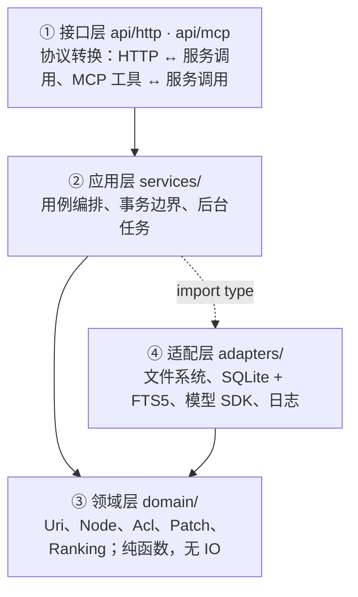

# CoMem

给 AI agent 一个稳定地址，让它在不同会话、不同机器、不同队友之间共享「它知道的东西」。

CoMem 是一个用 `comem://` 寻址的记忆数据库。记忆是磁盘上的 Markdown 文件，检索是 SQLite FTS5，
对外是一个 HTTP API、16 个 MCP 工具和一套 Nuxt 控制台。架构与设计写在
[`docs/architecture.md`](docs/architecture.md)，本文只讲「这是什么、怎么跑起来」。

## 解决什么问题

你在 Claude Code 里跟它说「我们这个项目不用 `any`，需要收窄时用 `unknown`」，它照做了。
第二天换一台机器、换一个会话，它又给你写出 `any`——**因为它只记得上下文窗口里的东西，而上下文窗口是会话级的**。

CoMem 把这类约定存成一个有地址的文件：

```
comem://user/alice/projects/comem/memories/preferences/no-any.md
```

下一次会话开始时，Hook 插件拿用户的 prompt 去 `find`，命中这条记忆就把摘要注入上下文；
这一轮结束后，`Stop` 把消息采集进会话，攒到阈值就提交归档、抽取成记忆。
agent 不需要「记得去记」，也不需要把整段历史重新读一遍。

## 核心概念

### URI 命名空间

所有东西都有地址，两个根，根下可以有项目作用域（§6.3）：

| 用途 | 真实 URI |
|---|---|
| 个人根 | `comem://user/alice/` |
| 个人记忆 | `comem://user/alice/memories/profile` |
| 项目作用域 | `comem://user/alice/projects/comem/memories/events/2026-11-05-architecture-decision` |
| 组空间 | `comem://group/eng/memories/conventions` |
| 会话 | `comem://user/alice/sessions/sess_7f3a91c2` |
| 资料 | `comem://user/alice/projects/comem/resources/docs/architecture` |
| 技能包 | `comem://user/alice/skills/code-review/SKILL` |

URI 先做 Unicode NFC 规范化，再合并重复斜杠、拒绝 `.` / `..` / 控制字符 / 保留名、单段上限 255 字节
（§6.2）。**规范化必须唯一**：权限按路径记录，同一个文件有两个路径就有两套权限，其中一套一定是错的。

### 三层摘要（L0 / L1 / L2）

同一份内容有三种粒度，按需加载（§9.1）：

| 层 | 落在哪 | 预算 | 用途 |
|---|---|---|---|
| L0 | `comem://user/alice/memories/.abstract.md` 的正文 | 256 字符 | 判断「这条和我有关吗」 |
| L1 | 同目录的 `.overview.md` 的正文 | 4000 字符 | 替代大部分原文阅读 |
| L2 | `comem://user/alice/memories/preferences/no-any` 原文 | 无限制 | 确定要用了才读 |

L0 从 L1 正文里提取，两层不会互相矛盾。**摘要是目录级的**，文件自己的摘要写在 frontmatter 的
`summary` 字段里（§6.7），跟着文件走，移动、复制、备份都不用单独维护。

### 目录级检索

检索的输入是一个查询，输出是「命中」：`uri` + 层级 + 摘要 + 分数。四个面各管一件事（§8.4）：

| 面 | 输入 | 什么时候用 |
|---|---|---|
| `find` | 一条查询 | 不知道内容在哪个目录 |
| `search` | 查询 + 会话 ID | 需要先做意图分析再检索 |
| `grep` | 正则 + 路径范围 | 知道大概在哪，要找具体那一行 |
| `glob` | 路径通配 | 只想要文件列表 |

排序分 = `bm25 × 层级权重`（L0 1.15 / L1 1.05 / L2 1.00，§8.5）。权重只用来在词频接近时打破平局：
L0 摘要经过一次压缩，信息密度更高；但 L2 的词频明显更高时仍然应该赢。

### 权限（ACL）

主体是 `user:alice`、`group:eng`、`user:*`；级别 `read = 1`、`write = 3`、`manage = 7`（高位包含低位）；
每个目录可以 `inherit`（继承祖先）或 `restricted`（切断继承）；同一节点上 `deny` 优先（§12.1、§12.2）。

授权写在目录的 `.acl.json` 里：

```json
{
  "mode": "inherit",
  "entries": [
    { "principal": "user:alice", "level": "manage", "effect": "allow" },
    { "principal": "group:eng", "level": "read", "effect": "allow" }
  ]
}
```

**ACL 不进 MCP。** 一个能给自己授权的 agent 就是提权漏洞，`get_acl` / `set_acl` 只走 Web 与 HTTP（§12.2）。
检索侧的权限是物化进 `node_permission` 表的（§8.2）：改 ACL 时算好，检索时是一个 `EXISTS` 子查询。

## 快速开始

需要 Node ≥ 22.5（`node:sqlite`）与 pnpm。

```bash
pnpm install
cd web && pnpm install && cd ..   # 控制台是独立包，有自己的 lockfile
pnpm dev
```

`cd web && pnpm install` 会触发 `web/package.json` 的 `postinstall`（`nuxt prepare`），在
`web/.nuxt/` 下生成 Nuxt 类型。这一步不能省：`web/tsconfig.json` 的 `extends` 指向
`.nuxt/tsconfig.json`，`pnpm test` 里的 `tests/unit/web/` 走 Vite 转译时会读它，缺了
直接报 `Cannot find module './.nuxt/tsconfig.json'`。`nuxt prepare` 只生成类型，不构建
产物（约 1 秒）。

`pnpm dev` 同时起后端（`http://127.0.0.1:1933`）与控制台（`http://127.0.0.1:3081`），
关掉任意一个两个都会停。后端启动输出（实测，`logging.level = info`）：

```
$ tsx src/bootstrap/main.ts
{"version":6,"dataDir":"/home/alice/.local/share/comem","level":"info","time":"...","msg":"数据库迁移完成。"}
{"recovered":0,"note":"没有需要回收的任务。","level":"info","time":"...","msg":"启动扫描完成。"}
{"url":"http://127.0.0.1:1933","dataDir":"/home/alice/.local/share/comem","level":"info","time":"...","msg":"CoMem 已启动"}
```

只要后端（`pnpm dev:server`）或只要控制台（`pnpm dev:web`）也单独可用。端口被占用时
`pnpm dev` 会明确报错而不是把控制台接到别的服务上：

```bash
COMEM_SERVER_PORT=1934 pnpm dev    # 两边一起换端口
```

数据根按运行形态推导（§6.5）：`COMEM_DATA_DIR` / `--data-dir` 优先，容器里是 `/var/lib/comem`，
桌面单用户是 `~/.local/share/comem`。不写 `config.yaml` 也能跑，全部配置项都有默认值。

一条命令看完整流程（临时数据根，不碰真实数据，也不需要模型凭据）：

```bash
pnpm test:e2e
```

它起服务、写记忆、检索、归档会话、跑完阶段二、过复核、生成摘要、演示 ACL，跑完自动停。

## 六条核心链路

排障按这六条走（验收点见 §20）。

| 链路 | 做什么 | 代码 |
|---|---|---|
| 会话归档 | 阶段一把消息移进 `history/archive_NNN/` 并建任务，阶段二在后台跑四个步骤；`.done` 最后写，它是唯一的完成信号 | `src/services/session.ts`、`src/services/commit/pipeline.ts` |
| 记忆抽取 | 按记忆类型预取相关文件塞进 prompt，模型输出「URI + 字段级合并操作」，`page_id` 由服务端映射回 URI | `src/services/commit/steps/memory-extract.ts`、`src/services/prompts/extract.ts` |
| 补丁合并 | 同 URI 的多条 patch 按顺序应用；SEARCH 必须唯一命中，命中零处或多处整条失败并记 `skippedOperations` | `src/domain/patch.ts`、`src/services/commit/steps/memory-merge.ts` |
| 摘要失效 | 子节点 L0 正文变了才向上传播；小目录（≤32 条）或 `pendingChanges / totalEntries ≥ 0.10` 立刻重算，否则只记脏 | `src/services/summary.ts`、`src/services/index-observer.ts` |
| 目录级检索 | 四个面统一按权限过滤；先取 `limit × 4` 候选再截断，避免过滤后不足数 | `src/services/search.ts`、`src/adapters/sqlite/retrieval-index.ts` |
| ACL 过滤 | 六个出口逐个求权；`restricted` 切断继承；owner 恒 `manage` 且不能被 ACL 收回 | `src/domain/acl.ts`、`src/services/acl.ts`、`src/adapters/sqlite/permission-repository.ts` |

## 架构

四层，依赖方向单向（§4.1、§4.2）：



| 首层目录 | 对应层 | 一句话 |
|---|---|---|
| `src/api/` | ① 接口层 | HTTP 与 MCP 两套协议 |
| `src/services/` | ② 应用层 | 用例编排 |
| `src/domain/` | ③ 领域层 | 模型与规则，可穷举测试 |
| `src/adapters/` | ④ 适配层 | 文件系统、SQLite、模型、日志 |
| `src/config/`、`src/bootstrap/` | — | 装配输入与依赖装配 |
| `web/` | — | Nuxt 3 控制台，独立构建 |
| `integrations/` | — | 六个 Hook 插件（Claude Code、DSH），独立交付物 |

依赖规则用 ESLint `no-restricted-imports` 强制：`domain/` 不出现 `node:fs` / `node:sqlite` / `fetch`，
`services/` 不出现 `ai`，`services/` 只能用 `import type` 引用 `adapters/`。这不是风格问题——领域层一旦碰 IO，
ACL 求值就没法用内存数据穷举测试。

内容存文件系统、索引存 SQLite 的理由见 §7；为什么只有 16 个 MCP 工具见 §13。

## 文档索引

| 文档 | 内容 |
|---|---|
| [`docs/architecture.md`](docs/architecture.md) | 架构与设计的唯一真相（21 节：分层、数据布局、六条链路、错误模型、里程碑） |
| [`docs/operations.md`](docs/operations.md) | 部署、配置、数据布局、备份、监控、排障、已知限制 |
| [`integrations/README.md`](integrations/README.md) | Hook 插件：安装、六个 hook、bypass、去重、HTTP 契约 |

## 开发

```bash
pnpm verify     # typecheck + lint + 单元/集成测试 + Hook 测试
```

四道门禁串行跑，任一道红就停。单独跑：

| 命令 | 内容 |
|---|---|
| `pnpm typecheck` | `tsc --noEmit`，`strict: true` + `noUncheckedIndexedAccess` |
| `pnpm lint` | ESLint：分层依赖规则在这里生效 |
| `pnpm test` | vitest：`tests/unit`（领域纯函数）与 `tests/integration`（临时目录 + 内存数据库） |
| `pnpm test:integrations` | `node --test integrations/tests/`：Hook 插件的去重、游标、锁、超时预算 |

测试不 mock 文件系统和数据库：用 `fs.mkdtemp()` 建临时目录、SQLite 用 `:memory:`。
六条核心链路每条都有对应的集成测试（§20）。本次实测（2026-11-08）：73 个测试文件、
1514 个用例通过、1 个跳过（跨设备 `move` 的 `EXDEV` 分支）；`integrations/` 107 个
用例全部通过；`pnpm verify` 退出码 0。

## 许可证

[AGPL-3.0](LICENSE)。

自托管自用不受限制；**把它作为服务提供给他人使用时，需要公开修改后的源码**。如果你的场景不能接受这一条，可以在 fork 后更换许可证——代码本身不依赖 AGPL 的任何特性。
